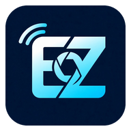

<div align="center">



# EZ-Cam-Mic

**Turn your Android phone into a Wi-Fi & USB webcam and microphone for your PC.**

Streams video (MJPEG) and audio (16-bit PCM WAV) directly to your local network. Pairs with [StreamBridge](https://github.com/roaxio/StreamBridge) to provide a virtual webcam and microphone for Zoom, Discord, OBS, and other PC applications.

</div>

---

## Features

| Capability | Details |
|:---|:---|
| 📹 **Video** | Low-latency MJPEG up to 1080p, configurable quality, and lens-native frame rates (up to 60 FPS) |
| 🎙️ **Audio** | 16-bit mono PCM WAV (44.1 kHz) with hardware noise suppression & echo cancellation (on supported devices) |
| 🔍 **Camera** | Multi-lens selection (front, back, ultra-wide), optical/digital zoom, torch, mirror, & orientation lock |
| 🌐 **Connectivity** | Stream over Wi-Fi or USB tethering (independently toggleable) |
| 🖥️ **Web Dashboard** | Built-in browser interface with live preview, stream URLs, and remote controls |
| 🔒 **Security** | Optional HTTPS encryption (self-signed cert) and HTTP Basic authentication |
| 🔔 **Smart Notification** | Live status (endpoint URL, connected clients, cam/mic state) with quick actions for Mute, Cam On/Off, & Stop |
| 🔋 **Power Saving** | AMOLED screen blackout mode to conserve battery and GPU thermals while streaming |

## Stream URLs

Default port: **4747** (configurable in Settings).

- **Web Dashboard:** `http://<phone-ip>:4747/`
- **Video (MJPEG):** `http://<phone-ip>:4747/video`
- **Audio (PCM WAV):** `http://<phone-ip>:4747/audio.wav`

## HTTPS and login

- **HTTPS** is on by default. The phone creates a self-signed certificate each time the app
  starts, so browsers show a warning you have to accept. Turn HTTPS off in Settings for plain
  `http://`.
- **Login** is off by default. When enabled, clients authenticate with HTTP Basic auth
  (`https://user:pass@IP:4747/video`) or with `?user=...&pass=...` in the URL
  (useful for OBS/VLC). The default credentials are `admin` / `admin123`; change them in
  Settings if you enable login.

## Using it with StreamBridge

Get the PC companion app: [roaxio/StreamBridge](https://github.com/roaxio/StreamBridge).

1. Start streaming in EZ-Cam-Mic and note the address shown in the app (e.g. `http://192.168.1.50:4747/video`).
2. In StreamBridge, enter `http://192.168.1.50:4747/video` as the camera URL and `http://192.168.1.50:4747/audio.wav` as the microphone URL.
3. If you enabled login, enter the same username and password in StreamBridge.

## Building

Requirements: JDK 17 or newer and the Android SDK (Android Studio installs both). The SDK
location comes from `ANDROID_HOME` or from `local.properties` (`sdk.dir=...`), which Android
Studio creates automatically.

```bash
# Linux / macOS
./gradlew assembleDebug
```

```bat
:: Windows
gradlew.bat assembleDebug
```

The debug APK is written to `app/build/outputs/apk/debug/app-debug.apk` and is signed with
the standard Android debug key. Run the unit tests with `gradlew testDebugUnitTest` and lint
with `gradlew lintDebug`.

The app version is defined once, in `gradle.properties` (`APP_VERSION_CODE`,
`APP_VERSION_NAME`).

> [!NOTE]
> Android will not allow installing a debug APK over a release APK (or vice versa) because they are signed with different keys. Uninstall any existing release build first before installing a locally built debug APK.

## Documentation & Security

- [Architecture Overview](docs/ARCHITECTURE.md)
- [Security Policy](SECURITY.md)

## License

[Apache License 2.0](LICENSE).

The web dashboard bundles the Plus Jakarta Sans and JetBrains Mono fonts, licensed under the
SIL Open Font License 1.1 (see `app/src/main/resources/fonts/OFL-*.txt`).
