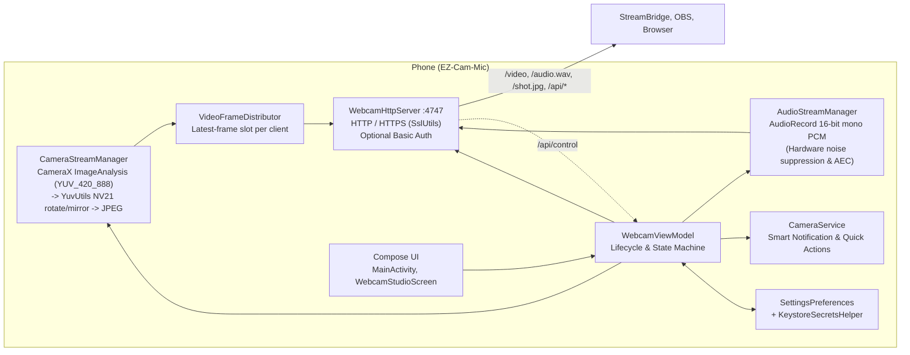

# Architecture



---

## Component Overview

### 1. Application & UI Tier
* **`MainActivity`**
  - Single-activity Compose container configuring edge-to-edge layout and window flags.
  - Requests runtime permissions (`CAMERA`, `RECORD_AUDIO`, and `POST_NOTIFICATIONS` on Android 13+).
  - Handles screen-awake flags (`FLAG_KEEP_SCREEN_ON`) when streaming.
* **`WebcamStudioScreen` & Settings Dialogs**
  - Interactive Compose UI displaying live preview, IP badges, audio RMS meters, FPS, and bitrates.
  - Provides quick controls for torch, zoom, mirroring, lens switching, and AMOLED blackout mode.

---

### 2. State Orchestration & Background Services
* **`WebcamViewModel`**
  - Central domain state machine managing camera, audio, HTTP server, and network interface lifecycles.
  - Symmetric startup and teardown: `startStreaming()` initiates the service, camera, audio, and server; `stopStreaming()` cleanly tears them down in reverse.
  - Background ticker updates stream stats (FPS, bitrate, connected clients, audio level) and emits state syncs.
* **`CameraService`**
  - Foreground service ensuring continuous execution under background, lock-screen, or AMOLED blackout states.
  - Declares Android 14+ service types: `camera`, `microphone`, and `connectedDevice`.
  - Posts and updates an interactive **Smart Notification** with live stream endpoint URL, client count, and status badges.
  - Provides direct notification quick actions: **Mute / Unmute Mic**, **Cam Off / Cam On**, and **Stop**.

---

### 3. Video Pipeline
* **`CameraStreamManager`**
  - Binds CameraX `Preview` and `ImageAnalysis` use-cases on the main thread.
  - Frames are analyzed on a dedicated worker thread: `YuvUtils` converts `YUV_420_888` to `NV21`, applying rotation and mirroring inside pre-allocated, reused memory buffers.
  - Encodes frames via `YuvImage.compressToJpeg` (configurable quality 30–95) and pushes them to the distributor.
  - **Audio-Only Standby**: When the camera is disabled ("Cam Off"), emits a lightweight 1 FPS placeholder frame to keep active video sessions connected.
* **`CameraSensorDiscovery` & `FpsSupport`**
  - Enumerates camera lenses, supported aspect ratios, and resolution profiles.
  - Detects sensor-supported target FPS options (`CONTROL_AE_TARGET_FPS_RANGE`) via Camera2Interop, choosing optimal auto-exposure ranges for low-light stability.
* **`VideoFrameDistributor`**
  - Non-blocking client delivery using an isolated latest-frame slot per connected MJPEG subscriber.
  - Writes `multipart/x-mixed-replace` boundaries across a cached thread pool. Slow network clients drop their own unsent frames without stalling the camera pipeline or other clients.

---

### 4. Audio Pipeline
* **`AudioStreamManager`**
  - Captures 16-bit mono PCM at 44.1 kHz via `AudioRecord` on `Dispatchers.IO`.
  - Automatically activates platform `NoiseSuppressor` and `AcousticEchoCanceler` when supported by hardware.
  - Applies configurable digital software gain and computes real-time RMS amplitude for UI metering.
  - Distributes audio into bounded per-client queues (dropping oldest chunks under backpressure).
  - Streams an initial continuous WAV header followed by raw PCM. When muted, streams zeroed silence buffers to preserve client sync without recording hardware.

---

### 5. Embedded HTTP Server
* **`WebcamHttpServer`**
  - Built on raw `ServerSocket` / `SSLServerSocket`, bound to `0.0.0.0:4747` (configurable).
  - Coroutine accept loop dispatches connections to a bounded thread pool sized dynamically by `DynamicResourceBudgets` (preventing CPU/memory starvation).
  - Distinguishes Wi-Fi and USB tethering interfaces (`rndis`, `usb`, `ncm`) with independent stream toggles.
* **Endpoints:**
  - `/` or `/index.html`: Web dashboard (`HtmlDashboard`).
  - `/video`: Low-latency MJPEG stream (`multipart/x-mixed-replace`).
  - `/audio.wav`: Continuous 16-bit PCM WAV stream.
  - `/shot.jpg`: Single JPEG snapshot.
  - `/api/status`: Real-time JSON telemetry (clients, FPS, bitrate, battery, resolution).
  - `/api/control`: Remote control actions (`torch`, `camera`, `cam`, `mute`, `quality`, `fps`, `zoom`).
  - `/fonts/`: Serves offline bundled dashboard fonts (`StaticFonts`) with zero outbound CDN traffic.

---

### 6. Security & Persistence
* **`SslUtils`**
  - Generates an in-memory 2048-bit RSA self-signed certificate using BouncyCastle per application process.
* **Authentication**
  - Supports HTTP Basic Auth (`Authorization: Basic ...`) and query parameter credentials (`?user=...&pass=...`) for software without header support (e.g. OBS/VLC).
* **`SettingsPreferences` & `KeystoreSecretsHelper`**
  - Persists configuration in private `SharedPreferences`.
  - Encrypts sensitive authentication passwords using AES-256-GCM backed by hardware Android Keystore keys.

---

## Pairing with StreamBridge

[StreamBridge](https://github.com/roaxio/StreamBridge) connects to EZ-Cam-Mic over local Wi-Fi or USB tethering:
1. Connects to `http(s)://<phone-ip>:4747/video` for video frames.
2. Connects to `http(s)://<phone-ip>:4747/audio.wav` for audio PCM frames.
3. Exposes virtual webcam and microphone devices on Windows/Linux for Zoom, Teams, Discord, and OBS.

---

## Release & Versioning

- Version coordinates are declared once in `gradle.properties`:
  - `APP_VERSION_CODE`: Numeric build counter.
  - `APP_VERSION_NAME`: Semantic version string (e.g., `1.0.0`).
- Both `build.gradle.kts` and the server's `Server: EZCamMic/<version>` header dynamically read `BuildConfig.VERSION_NAME`.
- The GitHub Actions `release.yml` workflow verifies version tags against `APP_VERSION_NAME`, runs automated tests and linting, and produces signed release artifacts.

---

## Project Structure

```text
app/src/main/kotlin/
├── MainActivity.kt               # Single-activity Compose host & permissions
├── CameraService.kt              # Foreground service, smart notification & actions
├── audio/                        # AudioRecord capture, hardware effects (AEC/NS) & WAV streaming
├── camera/                       # CameraX pipeline, YUV-to-NV21 conversion & FPS selection
├── data/                         # SharedPreferences persistence layer
├── model/                        # Immutable data models & configuration definitions
├── server/                       # Socket server, SSL engine, MJPEG distributor & web dashboard
├── ui/                           # Jetpack Compose studio screen, preview & settings dialogs
├── utils/                        # Network interface discovery & Keystore AES-GCM encryption
└── viewmodel/                    # Central domain state machine & telemetry flows

app/src/main/resources/fonts/     # Bundled offline dashboard web fonts (OFL 1.1)
app/src/test/kotlin/              # Robolectric & JVM unit test suites
```
